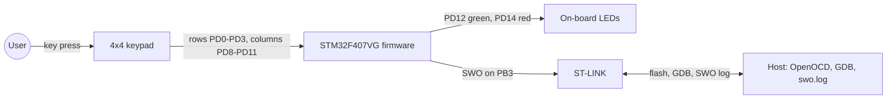
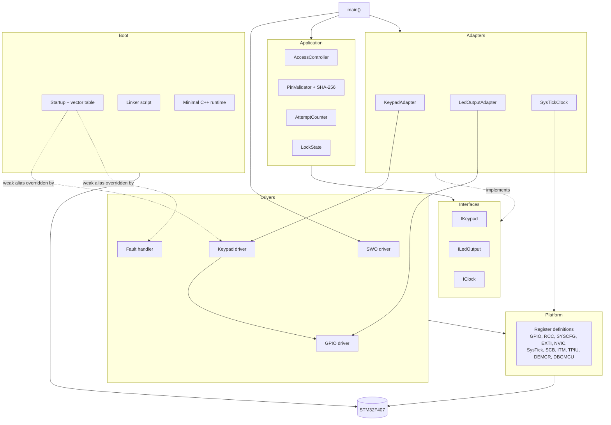
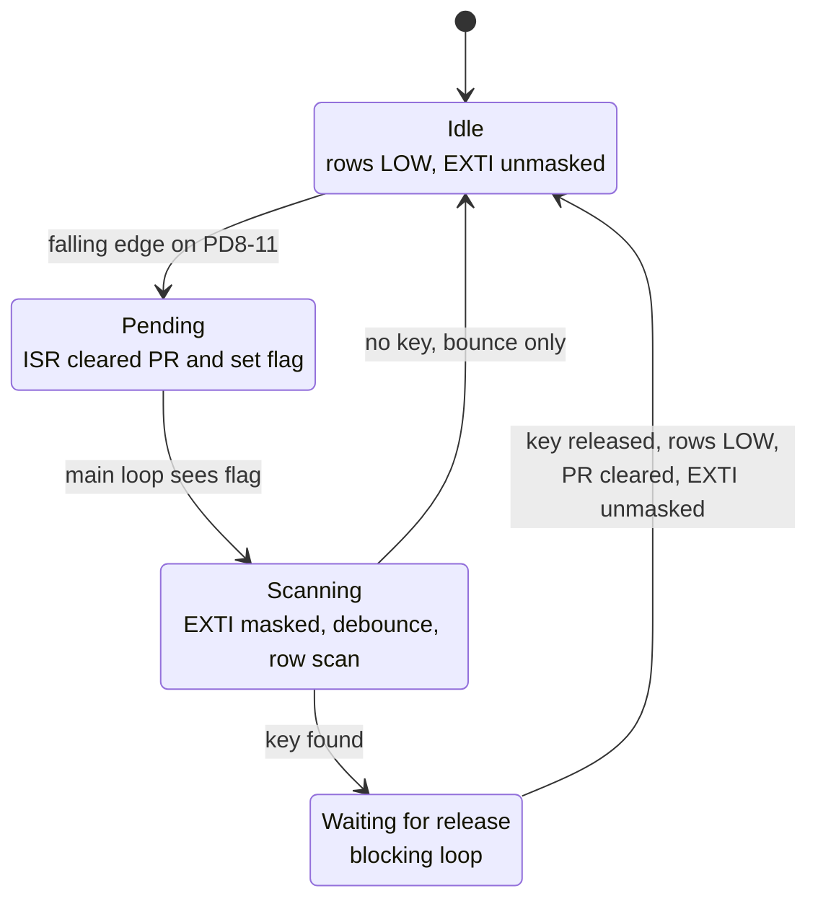
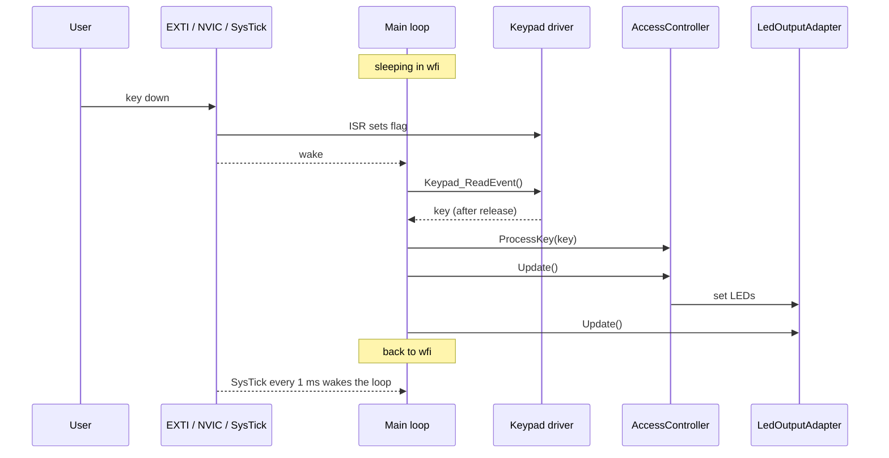
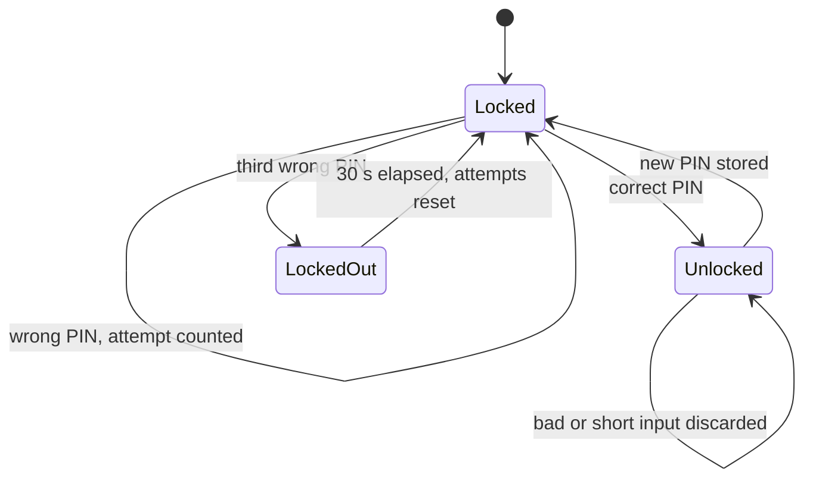
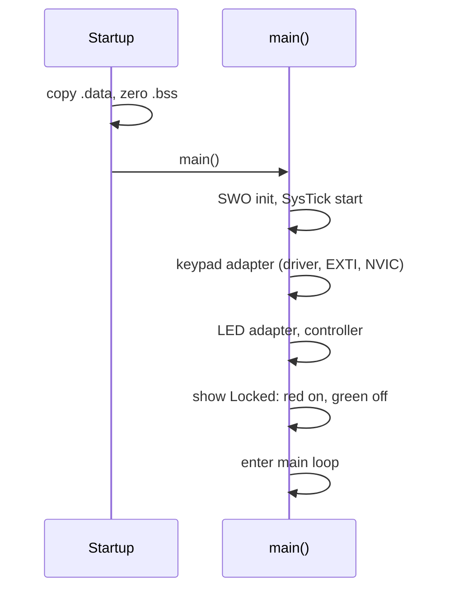

# Architecture and Design — STM32F407 Register-Level Access Control System

> **Status:** retrospective baseline v0.3, reverse-engineered from source, tests and the existing
> hardware docs. Pairs with `requirements.md` v0.1 (what the system does).
> This document says how it is built. Hardware verification status lives in the requirements, not here.
> Items marked **[confirm]** are inferred and need a check against the source.

**Contents:** 1 Architecture sketch · 2 Module design · 3 Interrupt and state logic · 4 Design decisions · 5 Tests · 6 Sharp edges

---

# 1. Architecture sketch

## The idea in one paragraph

A four-digit PIN goes in through a 4×4 keypad, two LEDs say what happened. The *logic* (PINs,
attempts, lockout) is plain C++ that has never heard of an STM32. The *hardware* (EXTI, SysTick,
GPIO registers) lives in small drivers that have never heard of a PIN. A thin adapter layer keeps
the two worlds apart. No HAL, no CubeMX, no RTOS, custom startup code and linker script.

## System context



## Layers and modules



Dependencies only point down. The application never includes a register header.
Exception worth knowing: `SysTickClock` touches the SysTick registers directly, since that is the only
place the application meets the timer. A separate timer driver would be a clean refinement.

## Hardware peripherals in use

| Peripheral | Base | Used for | Owner |
|---|---|---|---|
| RCC | 0x40023800 | clocks for GPIOD and SYSCFG (`APB2ENR.SYSCFGEN`) | drivers |
| GPIOD | 0x40020C00 | keypad rows/columns, LEDs | GPIO driver |
| SYSCFG | 0x40013800 | route port D to EXTI8–11 (`EXTICR3`) | keypad driver |
| EXTI | 0x40013C00 | falling-edge detection (`FTSR`, `IMR`, `PR`, `SWIER`) | keypad driver |
| NVIC | 0xE000E100 | enable IRQ 23 (ISER0 bit 23) and IRQ 40 (ISER1 bit 8) | keypad driver |
| SysTick | 0xE000E010 | 1 ms time base | `SysTickClock` |
| SCB | 0xE000ED28 | fault status (CFSR, HFSR, MMFAR, BFAR) | fault handler |
| ITM / TPIU / DEMCR / DBGMCU | see §2.9 | SWO trace output | SWO driver |

NVIC, SysTick, SCB, ITM, TPIU and DEMCR belong to the Cortex-M4 *core*, not to the STM32 peripheral set.
The GPIOD address follows from the GPIO base 0x40020000 plus port offset **[confirm]**.

## Memory layout

| Region | Address | Size | Content |
|---|---|---|---|
| Flash | 0x08000000 | 1024 KB | vector table, `.text`, read-only data, initial values of `.data` |
| RAM | 0x20000000 | 128 KB | `.data`, `.bss`, stack at the very end (`_estack = ORIGIN(RAM) + LENGTH(RAM)`) |

---

# 2. Module design

Each module: purpose, inputs, outputs, dependencies.

## 2.1 `AccessController` (application)

| | |
|---|---|
| **Purpose** | The brain. Three-state machine (Locked, Unlocked, LockedOut): collects PIN input, decides, drives the LEDs, runs the lockout. |
| **Inputs** | `ProcessKey(key)` for each key; `Update()` called from the main loop; time via `IClock::NowMs()` |
| **Outputs** | LED commands (green, red, blink) via `ILedOutput`; internal state change |
| **Depends on** | `PinValidator`, `AttemptCounter`, `LockState`, `IClock`, `ILedOutput` (injected through the constructor **[confirm]**) |
| **Owns** | four-digit input buffer, `lockoutStartMs_`, `kLockoutMs` (30 s) |

`ProcessKey()` serves `Locked` and `Unlocked`, so both behave the same:

- digits fill the buffer, `#` submits it
- any other key, or a fifth digit, aborts the input and clears the buffer
- aborted or short input never counts as a failed attempt; only a complete, wrong PIN does

Lockout check on every `Update()`, wraparound-safe because the subtraction is unsigned 32-bit:

```cpp
(clock_.NowMs() - lockoutStartMs_) >= kLockoutMs
```

## 2.2 `PinValidator` and SHA-256 (application)

| | |
|---|---|
| **Purpose** | Hold and check the PIN without ever storing the digits |
| **Inputs** | four digits to validate; four digits for `SetPin()` |
| **Outputs** | match / no match; replaced hash |
| **Depends on** | SHA-256 (`sha256.c/.h`) only |
| **State** | PIN hash in RAM, default PIN `1234`; a changed PIN lives until reset, nothing goes to flash |

## 2.3 `AttemptCounter` and `LockState` (application)

| Module | Purpose | Inputs | Outputs | Depends on |
|---|---|---|---|---|
| `AttemptCounter` | counts failed complete submissions, signals the third | register failure, reset **[confirm API]** | count / limit reached | nothing |
| `LockState` | the three states as a small enum (`uint8_t` base) | n/a | n/a | nothing |

## 2.4 Interfaces

| Interface | Contract | Production | Test double |
|---|---|---|---|
| `IKeypad` | give the next key, or "none" **[confirm]** | `KeypadAdapter` | `MockKeypad` |
| `ILedOutput` | show locked, unlocked, lockout-blink **[confirm]** | `LedOutputAdapter` | `MockLedOutput` |
| `IClock` | `NowMs()`, monotonic milliseconds, `uint32_t` | `SysTickClock` | `MockClock` |

The application depends only on these three.

## 2.5 Adapters

| Module | Purpose | Inputs | Outputs | Depends on |
|---|---|---|---|---|
| `KeypadAdapter` | implements `IKeypad`; `Scan` turns driver events into key characters | `Keypad_ReadEvent()` | key to the controller | keypad driver |
| `LedOutputAdapter` | implements `ILedOutput`; sets PD12/PD14, blinks red in lockout | commands from the controller; `Update()` calls | GPIO writes | GPIO driver |
| `SysTickClock` | implements `IClock`; `Init()` starts a 1 ms tick, `SysTick_Handler` increments a counter | SysTick interrupt | `NowMs()` | SysTick registers |

`SysTickClock` constants: reload `16000000 / 1000 - 1 = 15999`, `SYST_CSR = 0x7`
(enable, interrupt, processor clock). `kCoreClockHz` in `App/Adapters/SysTickClock.cpp` must change
together with the clock (see §4).

## 2.6 Keypad driver

| | |
|---|---|
| **Purpose** | Everything between the pins and a key event: pin setup, interrupt arming, debounce, matrix scan, release wait |
| **Inputs** | falling edges on PD8–PD11 via EXTI; GPIO input levels |
| **Outputs** | key events via `Keypad_ReadEvent()`; pending state via `Keypad_IrqPending()` |
| **Depends on** | GPIO driver, register definitions (SYSCFG, EXTI, NVIC) |

| Function | Role |
|---|---|
| `Keypad_Init()` | clocks, GPIO setup, `Keypad_SetIdle()`, EXTI and NVIC configuration (via `Keypad_EnableInterrupt()` **[confirm]**) |
| `Keypad_SetIdle()` | all rows LOW, ready for the next falling edge |
| `Keypad_IrqPending()` | has an ISR flagged a press? |
| `Keypad_ReadEvent()` | mask, debounce, scan, wait for release, restore idle, unmask, return the key |
| `EXTI9_5_IRQHandler`, `EXTI15_10_IRQHandler` | clear `EXTI->PR`, set the flag, nothing else |

Pins:

| Signal | Pin | Direction | Configuration |
|---|---|---|---|
| Row 1–4 | PD0–PD3 | output | idle LOW |
| Column 1–4 | PD8–PD11 | input | pull-up, EXTI8–11 |

Key layout (row-major, scanned rows 0→3, columns 0→3, first LOW column wins):

```text
1 2 3 A
4 5 6 B
7 8 9 C
* 0 # D
```

Only digits and `#` mean something to the controller; `A`–`D` and `*` count as invalid input.

## 2.7 GPIO driver

| | |
|---|---|
| **Purpose** | Pin mode, output type, speed, pull configuration, read and write pins |
| **Inputs** | port, pin, mode/level requests |
| **Outputs** | register writes (`MODER`, `OTYPER`, `OSPEEDR`, `PUPDR`, `ODR`), pin level reads (`IDR`) |
| **Depends on** | register definitions, RCC clock enable |

LEDs: green PD12, red PD14.

## 2.8 Boot: startup, linker script, C++ runtime

| | |
|---|---|
| **Purpose** | Get from reset to `main()` with initialized memory |
| **Inputs** | reset; linker symbols `_estack`, `_sidata`, `_sdata`, `_edata`, `_sbss`, `_ebss` |
| **Outputs** | initialized RAM, running `main()` |
| **Depends on** | linker script |


- **Weak aliases:** every unimplemented vector points to a default handler as a weak alias. Defining a
  function with the same name anywhere (an ISR, `HardFault_Handler`) overrides it at link time, no
  startup change needed.
- **Minimal C++ runtime:** no full runtime, only the symbols the code really needs: pure-virtual
  handling (`__cxa_pure_virtual`) and unused delete operators.

## 2.9 Debugging modules: SWO driver and fault handler

| Module | Purpose | Inputs | Outputs | Depends on |
|---|---|---|---|---|
| SWO driver (`Drivers/swo.cpp/.h`) | trace output over ITM stimulus port 0, no UART | `swoInit(coreClockHz, baud)`, `swoPuts()` | characters on PB3 → ST-LINK → OpenOCD → `swo.log` | `Platform/debug_regs.h` |
| Fault handler (`Drivers/fault.cpp`) | crash dump on HardFault | fault exception | stacked registers and fault status over SWO, then loops forever | SWO driver, SCB registers |

SWO setup order: `DEMCR.TRCENA` → `DBGMCU_CR` trace pin (async) → TPIU pin protocol and prescaler
(`ACPR = 16000000 / 125000 - 1 = 127`) → unlock ITM (`LAR = 0xC5ACCE55`) → `TCR` → `TER` port 0 → `TPR`.

The HardFault handler is deliberately primitive. It is split into a naked trampoline that checks
bit 2 of `LR` (EXC_RETURN) to find the active stack (MSP or PSP), and a C function
`HardFault_Handler_C(frame)` that prints `R0–R3`, `R12`, `LR`, `PC`, `xPSR`, `CFSR`, `HFSR`, `MMFAR`,
`BFAR`. It uses no keypad, no interrupts, no application layer: after a fault nothing can be trusted.

## 2.10 Platform: register definitions

| | |
|---|---|
| **Purpose** | The only place that knows addresses and bit layouts |
| **Content** | `stm32f407xx.h` (GPIO, RCC, SYSCFG, EXTI, NVIC, SysTick, SCB), `Platform/debug_regs.h` (ITM, TPIU, DEMCR, DBGMCU), EXTI helper `stm32f407xx_exti.c/.h` |
| **Style** | C structs matching the peripheral memory layout, `volatile` access, no CMSIS header |

`volatile` matters here: pins change on their own, the EXTI pending bit is set by hardware, and the
millisecond counter is written in an ISR and read in the main loop.

---

# 3. Interrupt and state logic

## 3.1 What fires when

| Source | Vector | Handler | Does | Shares with main loop |
|---|---|---|---|---|
| Keypad columns PD8, PD9 | IRQ 23 (ISER0 bit 23, offset 0x9C) | `EXTI9_5_IRQHandler` | clear `EXTI->PR`, set flag | `volatile` pending flag |
| Keypad columns PD10, PD11 | IRQ 40 (ISER1 bit 8, offset 0xE0) | `EXTI15_10_IRQHandler` | clear `EXTI->PR`, set flag | same flag |
| SysTick | exception 15, no NVIC bit | `SysTick_Handler` | increment 32-bit ms counter | `volatile` counter |
| HardFault | exception 3 | `HardFault_Handler` | dump over SWO, loop forever | none |

Rule for every ISR: be short, touch no logic. All decisions happen in the main loop.

## 3.2 Arming the keypad interrupt

Done once in `Keypad_Init()`, in this order:

1. enable GPIOD clock and `SYSCFGEN` in `RCC->APB2ENR` (SYSCFG must be clocked before `EXTICR` is writable)
2. rows as outputs, columns as inputs with pull-up, `Keypad_SetIdle()` (rows LOW)
3. `SYSCFG->EXTICR3`: select port D for EXTI8–11
4. `EXTI->FTSR`: falling edge on lines 8–11
5. `EXTI->IMR`: unmask lines 8–11
6. NVIC: enable IRQ 23 and IRQ 40

## 3.3 Keypad cycle

Idle trick: with all rows LOW, a pressed key connects its column to a LOW row, the pull-up loses, the
column falls: a falling edge, no polling needed.



Why the mask: while the scan toggles rows, the columns toggle too. Without `IMR` masked the scan would
trigger its own interrupts. Clearing `PR` before unmasking removes the edges the scan itself caused.

## 3.4 Main loop and time



The loop ends in `wfi`. Key interrupts and the 1 ms SysTick both wake the CPU, so the controller is
updated at least once per millisecond. That is what drives the lockout timeout and the LED blinking,
no scheduler, no timer callback. Order of calls inside the loop **[confirm]**.

## 3.5 Access state machine



| State | LEDs | Keypad | Leaves when |
|---|---|---|---|
| Locked | red on, green off | digits and `#` | correct PIN, or third failure |
| Unlocked | green on, red off | new PIN and `#` | valid new PIN stored |
| LockedOut | red blinking, green off | ignored, not even scanned | `kLockoutMs` elapsed |

On the third failure `lockoutStartMs_` is set. On expiry the controller returns to `Locked`, resets the
attempt counter and clears the input buffer.

## 3.6 Boot to running



Exact init order **[confirm]**.

---

# 4. Design decisions

| Decision | Reason | Price |
|---|---|---|
| No HAL, no CubeMX | learn the MCU, own the whole stack | every register definition is ours |
| Custom startup and linker script | understand boot, vector table, memory init | maintained by hand |
| Interfaces between app and hardware | run the logic on a PC, swap hardware | one adapter layer more |
| ISR only clears and flags | short interrupts, logic in the main loop | single flag, no queue |
| Debounce and scan outside the ISR, EXTI masked | no re-triggering by bounce or by the scan itself | busy-loop delay, not time-calibrated |
| Injected clock | instant, deterministic lockout tests, wraparound testable | `SysTickClock` must be running |
| `wfi` main loop | low power, wakes on key or tick | relies on the 1 ms tick |
| Hash instead of plaintext PIN | no PIN digits in RAM | hash code size |
| 16 MHz HSI, no PLL | simplest valid clock tree | constants tied to 16 MHz |
| SWO at 125 kHz | 2 MHz was garbled on this ST-LINK | slow trace |

**Clock dependency, three places must change together:** the core-clock argument of `swoInit()`, the
matching value in `scripts/swo.gdb`, and `kCoreClockHz` in `SysTickClock.cpp`. The SWO baud rate
(125000) also lives in two places: `swoInit()` and the `monitor tpiu config` line.

**SWO note:** `ITM->TPR` should be `1` (unmask ports 0–7 for unprivileged code), as in the reference
manual. `0` only works today because `main()` runs privileged with no RTOS. Recheck this if that changes.

---

# 5. How it is tested

```text
AccessController → IKeypad / ILedOutput / IClock → MockKeypad / MockLedOutput / MockClock
```

| Level | What | How |
|---|---|---|
| Host, application | state machine, PIN logic, attempts, lockout | GoogleTest with mocks (`unit_tests`) |
| Host, driver | keypad driver with fake GPIO and EXTI | GoogleTest (`driver_tests`) |
| Host, platform | EXTI and NVIC helpers | GoogleTest (`platform_tests`) |
| Target | GPIO, pull-ups, EXTI, NVIC, software-triggered EXTI via `SWIER` | Unity on the board, output over SWO; GDB script |
| Simulation | simulated key presses, LED checks | Renode + Robot Framework (on hold) |
| Static analysis | clang-tidy, GCC warnings, MISRA (planned) | pre-commit hook, GitHub Actions |

The SWO driver and fault handler are not part of the host tests: they write to addresses that do not
exist on a PC.

Debug workflow: `make openocd` (terminal 1), `make swo` (terminal 2, flashes and starts with SWO),
`tail -f swo.log` (terminal 3). `make flash` alone does not configure SWO on the host side.

---

# 6. Sharp edges

Honest list of what the design trades away. Hardware verification is tracked in `requirements.md`.

- **The release loop blocks.** While a key is held, the main loop stalls: no LED blinking, no lockout check.
- **One flag, no queue.** Fast presses can merge or get lost.
- **Debounce is a busy loop,** its duration is not calibrated.
- **Blink rate follows `Update()` calls,** not a clock.
- **Ghosting with several keys held** is unexplored.
- **SysTick accuracy** depends on the HSI tolerance, so "30 s" is nominal.
- **Reset restores `1234`.** Intended, not yet tested on hardware.
- **`SysTickClock` reaches into registers** instead of using a driver.

Ideas if the keypad driver is ever redesigned: non-blocking release detection, a small event queue,
clock-based blink and debounce.

---

# Change history

| Version | Description |
|---|---|
| 0.3 | Added per-module design (purpose, inputs, outputs, dependencies), interrupt and state logic, boot, SWO and fault handler, memory layout, hardware peripherals. |
| 0.2 | Merged the earlier layer description with `requirements.md`. |
