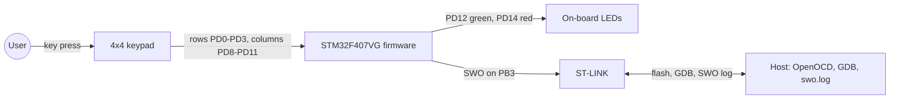
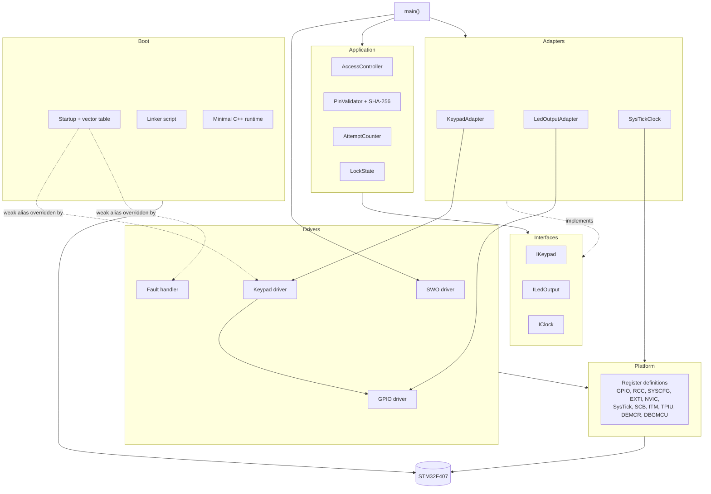

# Architecture — STM32F407 Register-Level Access Control System

> **Status:** retrospective (reverse v-model). Pairs with `requirements.md` (what the system does) and
> `design.md` (how each module works inside). This document is the big picture: structure, interfaces,
> decisions. Items marked **[confirm]** need a check against the source.

---

## The idea in one paragraph

A four-digit PIN goes in through a 4×4 keypad, two LEDs say what happened. The *logic* (PINs,
attempts, lockout) is plain C++ that has never heard of an STM32. The *hardware* (EXTI, SysTick,
GPIO registers) lives in small drivers that have never heard of a PIN. A thin adapter layer keeps
the two worlds apart. No HAL, no CubeMX, no RTOS, custom startup code and linker script.

## System context



## Layers and modules



Dependencies only point down. The application never includes a register header.
One exception worth knowing: `SysTickClock` touches the SysTick registers directly, since that is the
only place the application meets the timer. A separate timer driver would be a clean refinement.

## Modules at a glance

Details per module (inputs, outputs, algorithms) are in `design.md`.

| Layer | Module | One-line purpose |
|---|---|---|
| Application | `AccessController` | three-state machine: collects PIN input, decides, drives LEDs, runs the lockout |
| | `PinValidator` | holds and checks the PIN as a SHA-256 hash |
| | `AttemptCounter`, `LockState` | failed-attempt count, the three states |
| Interfaces | `IKeypad`, `ILedOutput`, `IClock` | keys in, LEDs out, time in |
| Adapters | `KeypadAdapter`, `LedOutputAdapter`, `SysTickClock` | implement the interfaces on top of the drivers |
| Drivers | keypad driver | pins, interrupt arming, debounce, matrix scan, release wait |
| | GPIO driver | pin modes, read and write |
| | SWO driver, fault handler | trace output, HardFault crash dump |
| Platform | register definitions | the only place that knows addresses and bit layouts |
| Boot | startup, linker script, C++ runtime | from reset to `main()` with initialized memory |

## Hardware peripherals in use

| Peripheral | Base | Used for | Owner |
|---|---|---|---|
| RCC | 0x40023800 | clocks for GPIOD and SYSCFG | drivers |
| GPIOD | 0x40020C00 **[confirm]** | keypad rows/columns, LEDs | GPIO driver |
| SYSCFG | 0x40013800 | route port D to EXTI8–11 | keypad driver |
| EXTI | 0x40013C00 | falling-edge detection | keypad driver |
| NVIC | 0xE000E100 | enable IRQ 23 and IRQ 40 | keypad driver |
| SysTick | 0xE000E010 | 1 ms time base | `SysTickClock` |
| SCB | 0xE000ED28 | fault status | fault handler |
| ITM / TPIU / DEMCR / DBGMCU | see `design.md` | SWO trace output | SWO driver |

NVIC, SysTick, SCB, ITM, TPIU and DEMCR belong to the Cortex-M4 *core*, not to the STM32 peripheral set.

## Memory layout

| Region | Address | Size | Content |
|---|---|---|---|
| Flash | 0x08000000 | 1024 KB | vector table, `.text`, read-only data, initial values of `.data` |
| RAM | 0x20000000 | 128 KB | `.data`, `.bss`, stack at the very end (`_estack = ORIGIN(RAM) + LENGTH(RAM)`) |

## Runtime in three sentences

Interrupts only flag, the main loop does the work. The loop polls continuously and updates the controller on every iteration. Time is injected
through `IClock`, never read from a register inside the logic. Sequences and state machines:
`design.md`.

---

## Design decisions

| Decision | Reason | Price |
|---|---|---|
| No HAL, no CubeMX | learn the MCU, own the whole stack | every register definition is ours |
| Custom startup and linker script | understand boot, vector table, memory init | maintained by hand |
| Interfaces between app and hardware | run the logic on a PC, swap hardware | one adapter layer more |
| ISR only clears and flags | short interrupts, logic in the main loop | single flag, no queue |
| Debounce and scan outside the ISR, EXTI masked | no re-triggering by bounce or by the scan itself | busy-loop delay, not time-calibrated |
| Injected clock | instant, deterministic lockout tests, wraparound testable | `SysTickClock` must be running |
| Polling main loop | simple control flow | CPU runs continuously |
| Hash instead of plaintext PIN | no PIN digits in RAM | hash code size |
| 16 MHz HSI, no PLL | simplest valid clock tree | constants tied to 16 MHz |
| SWO at 125 kHz | 2 MHz was garbled on this ST-LINK | slow trace |

**Clock dependency, three places must change together:** the core-clock argument of `swoInit()`, the
matching value in `scripts/swo.gdb`, and `kCoreClockHz` in `App/Adapters/SysTickClock.cpp`.

---

## How it is tested

```text
AccessController → IKeypad / ILedOutput / IClock → MockKeypad / MockLedOutput / MockClock
```

| Level | What | How |
|---|---|---|
| Host, application | state machine, PIN logic, attempts, lockout | GoogleTest with mocks (`unit_tests`) |
| Host, driver | keypad driver with fake GPIO and EXTI | GoogleTest (`driver_tests`) |
| Host, platform | EXTI and NVIC helpers | GoogleTest (`platform_tests`) |
| Target | GPIO, pull-ups, EXTI, NVIC, software-triggered EXTI via `SWIER` | Unity on the board, output over SWO; GDB script |
| Simulation | simulated key presses, LED checks | Renode + Robot Framework (on hold) |
| Static analysis | clang-tidy, GCC warnings, MISRA (planned) | pre-commit hook, GitHub Actions |

The SWO driver and fault handler are not part of the host tests: they write to addresses that do not
exist on a PC. Details and the requirement mapping go into `tests.md`.

---

## Sharp edges

- **The release loop blocks.** While a key is held, the main loop stalls: no LED blinking, no lockout check.
- **One flag, no queue.** Fast presses can merge or get lost.
- **Debounce is a busy loop,** its duration is not calibrated.
- **Blink rate follows `Update()` calls,** not a clock.
- **Ghosting with several keys held** is unexplored.
- **SysTick accuracy** depends on the HSI tolerance, so "30 s" is nominal.
- **Reset restores `1234`.** Verified on hardware (PIN changed, reset, default accepted).
- **`SysTickClock` reaches into registers** instead of using a driver.