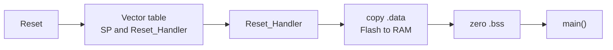
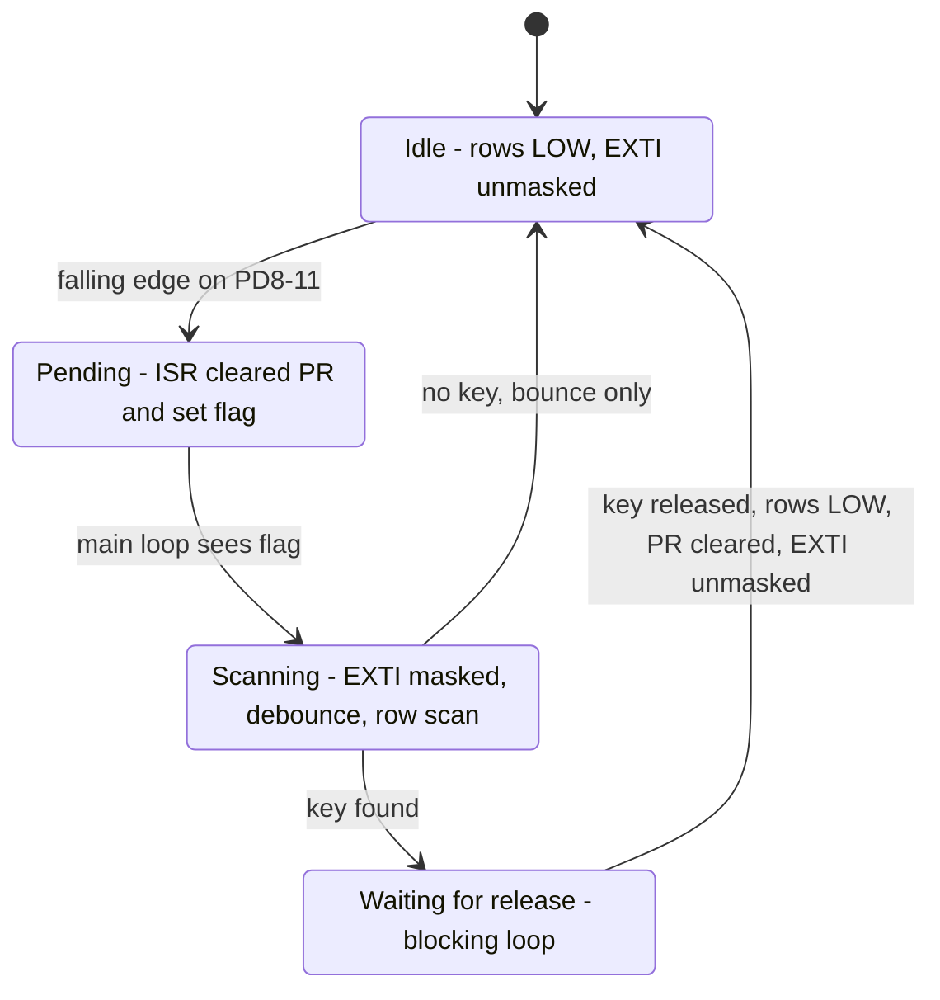
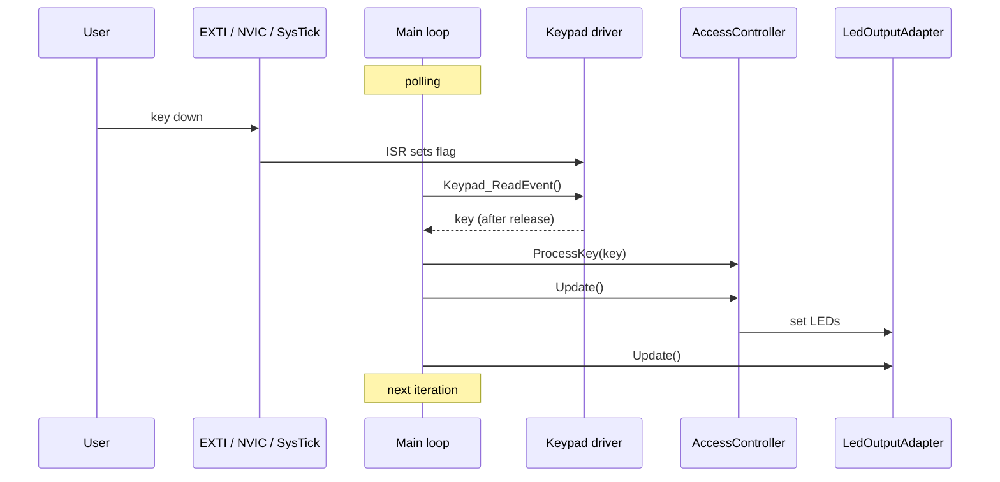
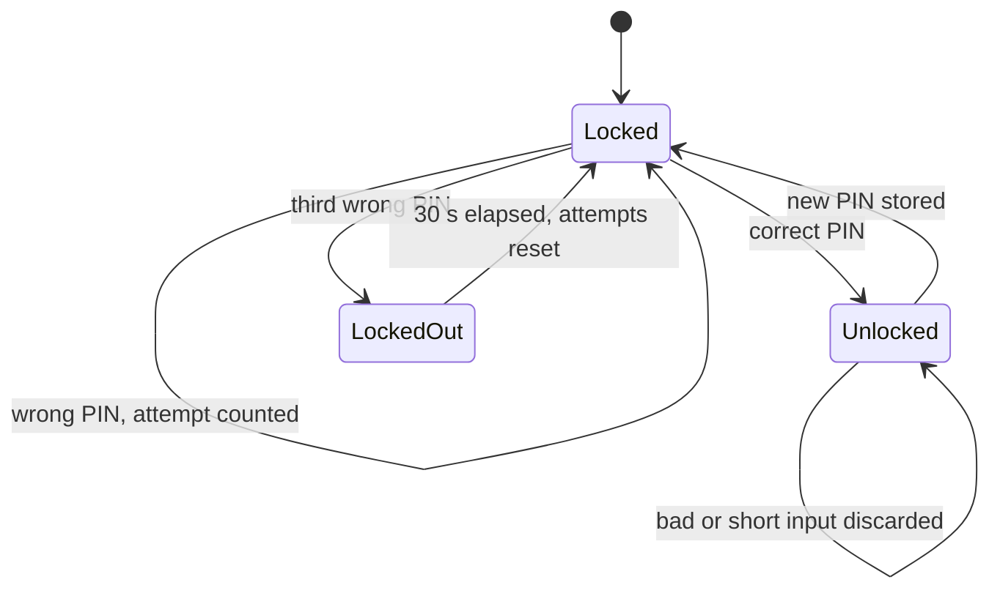
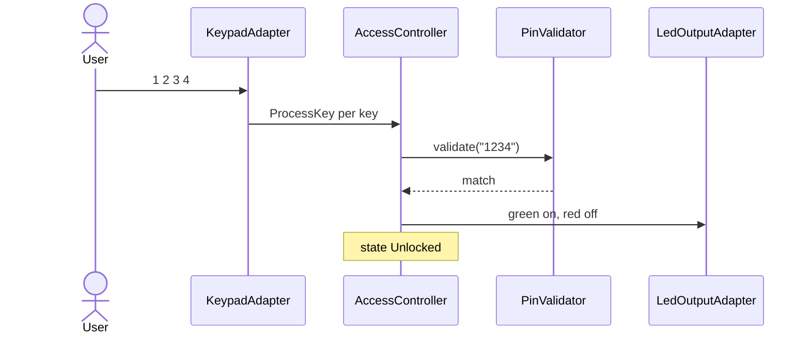
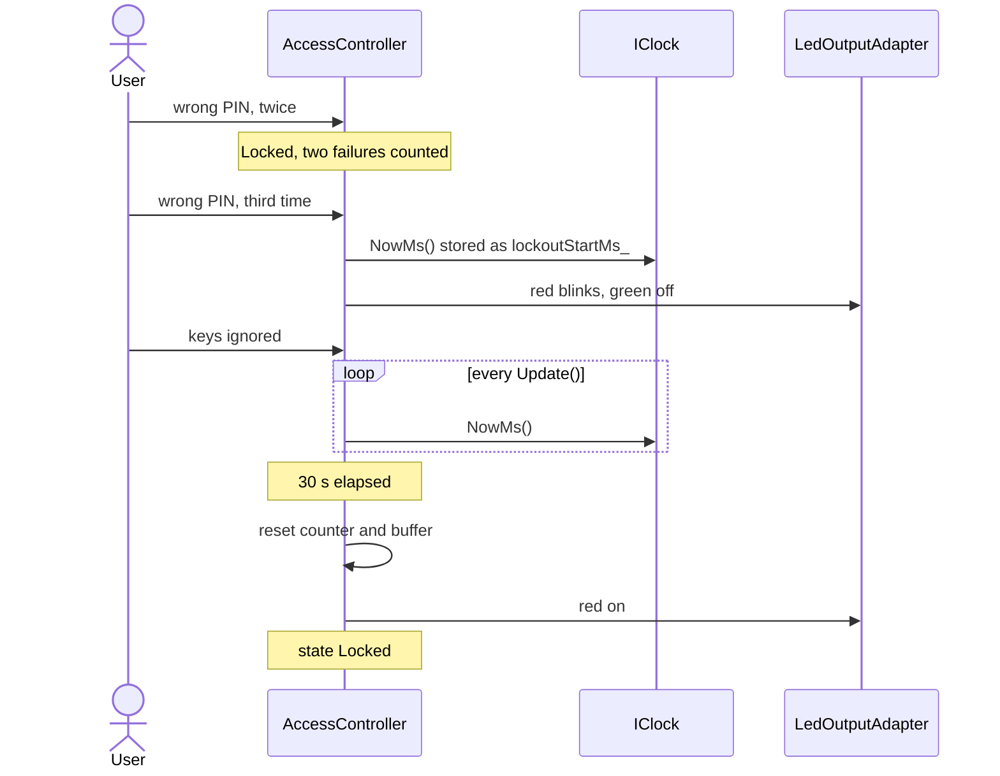
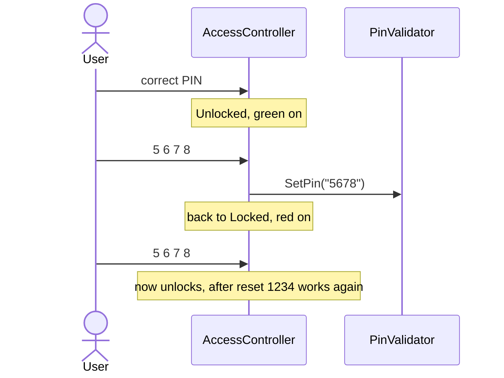

# Design — STM32F407 Register-Level Access Control System

> **Status:** retrospective, reverse-engineered from source, tests and hardware docs.
> Detailed design below the structure in `architecture.md`, tied to `requirements.md`.

**Contents:** 1 Module design · 2 Decision tables and algorithms · 3 Interrupt logic · 4 State machines · 5 Use cases ·  
6 Timing · 7 Error handling · 8 Open design questions

---

# 1. Module design

Each module: purpose, inputs, outputs, dependencies.

## 1.1 `AccessController` (application)

| | |
|---|---|
| **Purpose** | The brain. Three-state machine (Locked, Unlocked, LockedOut): collects PIN input, decides, drives the LEDs, runs the lockout. |
| **Inputs** | `ProcessKey(key)` per key; `Update()` from the main loop; time via `IClock::NowMs()` |
| **Outputs** | LED commands (green, red, blink) via `ILedOutput`; state change |
| **Depends on** | `PinValidator`, `AttemptCounter`, `LockState`, `IClock`, `ILedOutput`, `IKeypad` (injected through the constructor) |
| **Owns** | four-digit input buffer, `lockoutStartMs_`, `kLockoutMs` (30 s) |

## 1.2 `PinValidator` and SHA-256 (application)

| | |
|---|---|
| **Purpose** | Hold and check the PIN without ever storing the digits |
| **Inputs** | four digits to validate; four digits for `SetPin()` |
| **Outputs** | match / no match; replaced hash |
| **Depends on** | SHA-256 (`sha256.c/.h`) only |
| **State** | PIN hash in RAM, default PIN `1234`; a changed PIN lives until reset, nothing goes to flash |

## 1.3 `AttemptCounter` and `LockState` (application)

| Module | Purpose | Inputs | Outputs | Depends on |
|---|---|---|---|---|
| `AttemptCounter` | signals when `MaxAttempts`(3) is reached | register failure=`Increment()`, reset=`Reset()` | limit reached | nothing |
| `LockState` | the three states as a small enum (`uint8_t` base) | n/a | n/a | nothing |

## 1.4 Interfaces

| Interface | Contract | Production | Test double |
|---|---|---|---|
| `IKeypad` | give the next key, or "none" | `KeypadAdapter` uses `keypad.c`-Driver| `MockKeypad` |
| `ILedOutput` | show locked, unlocked, lockout-blink | `LedOutputAdapter` | `MockLedOutput` |
| `IClock` | `NowMs()`, monotonic milliseconds, `uint32_t` | `SysTickClock` | `MockClock` |

The application depends only on these three.

## 1.5 Adapters

| Module | Purpose | Inputs | Outputs | Depends on |
|---|---|---|---|---|
| `KeypadAdapter` | implements `IKeypad`; `Scan` turns driver events into key characters | `Keypad_ReadEvent()` | key to the controller | keypad driver |
| `LedOutputAdapter` | implements `ILedOutput`; sets PD12/PD14, blinks red in lockout | controller commands; `Update()` calls | GPIO writes | GPIO driver |
| `SysTickClock` | implements `IClock`; `Init()` starts a 1 ms tick, `SysTick_Handler` increments a counter | SysTick interrupt | `NowMs()` | SysTick registers |

`SysTickClock` constants: reload `16000000 / 1000 - 1 = 15999`, `SYST_CVR = 0`, `SYST_CSR = 0x7`:

| `SYST_CSR` bit | Name | Value | Meaning |
|---|---|---|---|
| 0 | ENABLE | 1 | counter running |
| 1 | TICKINT | 1 | interrupt at zero |
| 2 | CLKSOURCE | 1 | processor clock |

The tick interrupt is exception 15, not an NVIC IRQ, so no `ISER` bit is involved. `kCoreClockHz` in
`App/Adapters/SysTickClock.cpp` must change together with the clock.

## 1.6 Keypad driver

| | |
|---|---|
| **Purpose** | Everything between the pins and a key event: pin setup, interrupt arming, debounce, matrix scan, release wait |
| **Inputs** | falling edges on PD8–PD11 via EXTI; GPIO input levels |
| **Outputs** | key events via `Keypad_ReadEvent()`; pending state via `Keypad_IrqPending()` |
| **Depends on** | GPIO driver, register definitions (SYSCFG, EXTI, NVIC), EXTI helper |

| Function | Role |
|---|---|
| `Keypad_Init()` | clocks, GPIO setup, `Keypad_SetIdle()`, EXTI and NVIC configuration (via `Keypad_EnableInterrupt()` |
| `Keypad_SetIdle()` | all rows LOW, ready for the next falling edge |
| `Keypad_IrqPending()` | has an ISR flagged a press? |
| `Keypad_ReadEvent()` | mask, debounce, scan, wait for release, restore idle, unmask, return the key |
| `EXTI9_5_IRQHandler`, `EXTI15_10_IRQHandler` | clear `EXTI->PR`, set the flag, nothing else |

| Signal | Pin | Direction | Configuration |
|---|---|---|---|
| Row 1–4 | PD0–PD3 | output | idle LOW |
| Column 1–4 | PD8–PD11 | input | pull-up, EXTI8–11 |

```text
1 2 3 A
4 5 6 B
7 8 9 C
* 0 # D
```

Only digits and `#` mean something to the controller; `A`–`D` and `*` count as invalid input.

## 1.7 GPIO driver

| | |
|---|---|
| **Purpose** | Pin mode, output type, speed, pull configuration, read and write pins |
| **Inputs** | port, pin, mode/level requests |
| **Outputs** | register writes (`MODER`, `OTYPER`, `OSPEEDR`, `PUPDR`, `ODR`), pin level reads (`IDR`) |
| **Depends on** | register definitions, RCC clock enable |

LEDs: green PD12, red PD14. GPIO clocks must be enabled in RCC before any GPIO access.

## 1.8 Boot: startup, linker script, C++ runtime

| | |
|---|---|
| **Purpose** | Get from reset to `main()` with initialized memory |
| **Inputs** | reset; linker symbols `_estack`, `_sidata`, `_sdata`, `_edata`, `_sbss`, `_ebss` |
| **Outputs** | initialized RAM, running `main()` |
| **Depends on** | linker script |



- **Weak aliases:** every unimplemented vector points to a default handler as a weak alias. Defining a
  function with the same name anywhere (an ISR, `HardFault_Handler`) overrides it at link time, no
  startup change needed.
- **Minimal C++ runtime:** only the symbols the code really needs: pure-virtual handling
  (`__cxa_pure_virtual`) and unused delete operators.
- **Keypad vectors:** IRQ 23 `EXTI9_5_IRQHandler` and IRQ 40 `EXTI15_10_IRQHandler`; both defined in the
  keypad driver. Enabling them is not startup's job, it happens in `Keypad_Init()`.

## 1.9 Debugging modules: SWO driver and fault handler

| Module | Purpose | Inputs | Outputs | Depends on |
|---|---|---|---|---|
| SWO driver (`Drivers/swo.cpp/.h`) | trace output over ITM stimulus port 0, no UART | `swoInit(coreClockHz, baud)`, `swoPuts()` | characters on PB3 → ST-LINK → OpenOCD → `swo.log` | `Platform/debug_regs.h` |
| **(to be done)** Fault handler (`Drivers/fault.cpp`) | crash dump on HardFault | fault exception | stacked registers and fault status over SWO, then loops forever | SWO driver, SCB registers |

SWO register map (core: DEMCR, ITM, TPIU; chip: DBGMCU):

| Register | Address | Purpose |
|---|---|---|
| DEMCR | 0xE000EDFC | bit 24 `TRCENA` enables the trace blocks |
| DBGMCU_CR | 0xE0042004 | `TRACE_IOEN` (bit 5), `TRACE_MODE` (bits 7:6) |
| TPIU_ACPR | 0xE0040010 | baud prescaler |
| TPIU_SPPR | 0xE00400F0 | pin protocol (async NRZ) |
| TPIU_FFCR | 0xE0040304 | formatter control |
| ITM_STIM0 | 0xE0000000 | stimulus port 0 |
| ITM_TER / TPR / TCR / LAR | 0xE0000E00 / E40 / E80 / FB0 | enable ports, privilege mask, control, lock (`0xC5ACCE55`) |

SWO init order: `DEMCR.TRCENA` → `DBGMCU_CR` trace pin (async) → TPIU pin protocol and prescaler
(`ACPR = 16000000 / 125000 - 1 = 127`) → unlock ITM → `TCR` → `TER` port 0 → `TPR`.
The SWO pin PB3 uses alternate function 0. `ITM->TPR` should be `1`, as in the reference manual; `0`
only works while `main()` runs privileged with no RTOS.

HardFault handler:

- `HardFault_Handler` is a naked trampoline: tests bit 2 of `LR` (EXC_RETURN) to find the active
  stack (MSP or PSP), passes the frame pointer in `r0`.
- `HardFault_Handler_C(frame)` prints `R0–R3`, `R12`, `LR`, `PC`, `xPSR`, `CFSR`, `HFSR`, `MMFAR`,
  `BFAR`, then loops forever.
- It uses no keypad, no interrupts, no application layer: after a fault nothing can be trusted.

Reading a dump:

| Register | Meaning |
|---|---|
| `PC` | the faulting instruction (`arm-none-eabi-addr2line -e <elf> -f -C <PC>`); `LR` points into the caller |
| `CFSR` bits 0–7 / 8–15 / 16–31 | MemManage / BusFault / UsageFault (`PRECISERR` bit 9, `BFARVALID` bit 15, `UNDEFINSTR`, `DIVBYZERO` …) |
| `HFSR` bit 30 `FORCED` | a configurable fault escalated to HardFault, cause is in `CFSR` |
| `MMFAR`, `BFAR` | only valid if `MMARVALID` / `BFARVALID` is set in `CFSR` |

## 1.10 Platform: register definitions

| | |
|---|---|
| **Purpose** | The only place that knows addresses and bit layouts |
| **Content** | `stm32f407xx.h` (GPIO, RCC, SYSCFG, EXTI, NVIC, SysTick, SCB), `Platform/debug_regs.h` (ITM, TPIU, DEMCR, DBGMCU), EXTI helper `stm32f407xx_exti.c/.h` |
| **Style** | C structs matching the peripheral memory layout, `volatile` access, no CMSIS header |

`volatile` matters: pins change on their own, the EXTI pending bit is set by hardware, and the
millisecond counter is written in an ISR and read in the main loop.

---

# 2. Decision tables and algorithms

## 2.1 `ProcessKey()` decision table

`LockedOut` ignores all keys (the keypad is not even scanned). For `Locked` and `Unlocked`:

| Buffered digits | Key | Locked | Unlocked |
|---|---|---|---|
| 0–3 | digit | append | append |
| 4 | digit (fifth) | abort: clear buffer | abort: clear buffer |
| 4 | `#` | validate: correct → `Unlocked`; wrong → count failure, third → `LockedOut`; clear buffer | `SetPin()`, → `Locked`; clear buffer |
| 0–3 | `#` | discard, clear buffer, no attempt counted | discard, clear buffer, stay `Unlocked` |
| any | `A`–`D`, `*` | abort: clear buffer | abort: clear buffer |

Rules behind the table:

- only a complete four-digit PIN that does not match counts as a failed attempt
- every submit, abort or short `#` clears the buffer
- `Locked` and `Unlocked` share one function, so they cannot drift apart

## 2.2 Lockout algorithm

```text
on third failure:   lockoutStartMs_ = clock.NowMs();  state = LockedOut;  red blinks
every Update():     if state == LockedOut and (clock.NowMs() - lockoutStartMs_) >= kLockoutMs
                        state = Locked;  attemptCounter.Reset();  clear input buffer;  red on
```

Why the subtraction is safe at wraparound: both values are `uint32_t`, so `now - start` is computed
modulo 2^32 and equals the true elapsed time as long as it is below 2^32 ms (about 49.7 days). A
counter that wrapped between `start` and `now` gives the same correct result as one that did not.
`MockClock` can test this by starting near `0xFFFFFFFF`.

## 2.3 Keypad scan algorithm

```text
Keypad_ReadEvent():
    if no pending flag: return none
    mask EXTI lines 8-11 (IMR)
    busy-loop delay                         // debounce, not calibrated
    for row in 0..3:
        drive row LOW, others HIGH
        for col in 0..3:
            if column pin is LOW: key = map[row][col]; break
    wait while the key is still pressed     // blocking release loop
    busy-loop delay
    Keypad_SetIdle()                        // all rows LOW
    clear EXTI->PR, clear pending flag      // order of the two [confirm]
    unmask EXTI lines
    return key
```

Why `PR` is cleared before unmasking: the row toggling during the scan itself produces edges on the
columns; clearing `PR` throws them away so the scan does not retrigger itself.

---

# 3. Interrupt logic

## 3.1 What fires when

| Source | Vector | Handler | Does | Shares with main loop |
|---|---|---|---|---|
| Keypad columns PD8, PD9 | IRQ 23 (ISER0 bit 23, offset 0x9C) | `EXTI9_5_IRQHandler` | clear `EXTI->PR`, set flag | `volatile` pending flag |
| Keypad columns PD10, PD11 | IRQ 40 (ISER1 bit 8, offset 0xE0) | `EXTI15_10_IRQHandler` | clear `EXTI->PR`, set flag | same flag |
| SysTick | exception 15, no NVIC bit | `SysTick_Handler` | increment 32-bit ms counter | `volatile` counter |
| HardFault | exception 3 | `HardFault_Handler` | dump over SWO, loop forever | none |

Rule for every ISR: short, no logic. All decisions happen in the main loop.

## 3.2 Arming the keypad interrupt

Done once in `Keypad_Init()`:

1. enable the GPIOD clock and `SYSCFGEN` in `RCC->APB2ENR` (SYSCFG must be clocked before `EXTICR` is writable)
2. rows as outputs, columns as inputs with pull-up, `Keypad_SetIdle()` (rows LOW)
3. `SYSCFG->EXTICR3`: select port D for EXTI8–11 (EXTI line n always maps to pin n of the chosen port)
4. `EXTI->FTSR`: falling edge on lines 8–11
5. `EXTI->IMR`: unmask lines 8–11
6. NVIC: enable IRQ 23 (`ISER0` bit 23, 0xE000E100) and IRQ 40 (`ISER1` bit 8, 0xE000E104)

Related registers:

| Register | Purpose |
|---|---|
| `EXTICR1–4` | port selection for EXTI0–3 / 4–7 / 8–11 / 12–15 |
| `IMR` | interrupt mask (1 = enabled) |
| `RTSR`, `FTSR` | rising / falling trigger |
| `SWIER` | software trigger, used by tests and debugging |
| `PR` | pending flag, cleared by writing 1 |

## 3.3 Keypad cycle

Idle trick: with all rows LOW, a pressed key connects its column to a LOW row, the pull-up loses, the
column falls. A falling edge, no polling needed.



## 3.4 Main loop



Order of calls inside the loop **[confirm]**.

---

# 4. State machines

## 4.1 Access state machine



| State | LEDs | Keypad | Leaves when |
|---|---|---|---|
| Locked | red on, green off | digits and `#` | correct PIN, or third failure |
| Unlocked | green on, red off | new PIN and `#` | valid new PIN stored |
| LockedOut | red blinking, green off | ignored | `kLockoutMs` elapsed |

## 4.2 Transition table

| From | Event | Guard | Action | To |
|---|---|---|---|---|
| Locked | `#` | 4 digits, PIN matches | clear buffer | Unlocked |
| Locked | `#` | 4 digits, no match, failures < 3 | count failure, clear buffer | Locked |
| Locked | `#` | 4 digits, no match, failure is the third | count, store `lockoutStartMs_`, clear buffer | LockedOut |
| Locked | `#` | fewer than 4 digits | clear buffer | Locked |
| Locked | digit / other key | fifth digit or non-digit | clear buffer | Locked |
| Unlocked | `#` | 4 digits | `SetPin()`, clear buffer | Locked |
| Unlocked | `#` | fewer than 4 digits | clear buffer | Unlocked |
| Unlocked | other key | fifth digit or non-digit | clear buffer | Unlocked |
| LockedOut | `Update()` | elapsed ≥ `kLockoutMs` | reset counter, clear buffer | Locked |
| LockedOut | any key | none | ignored | LockedOut |

---

# 5. Use cases

## 5.1 Correct PIN



## 5.2 Three failures and lockout



## 5.3 PIN change



---

# 6. Timing

| Item | Value | Basis |
|---|---|---|
| Core clock | 16 MHz HSI, no PLL | nominal, no calibration |
| Tick | 1 ms (`SYST_RVR = 15999`) | `SysTickClock` |
| Counter | 32-bit, wraps after about 49.7 days | wraparound-safe subtraction |
| Lockout | 30,000 ms | `kLockoutMs`; resolution about 1 ms, absolute accuracy depends on HSI tolerance |
| Controller update rate | continuous polling, not tied to the tick | main loop |
| Debounce | busy-loop delay | not specified, not calibrated |
| LED blink | per `Update()` call count | not clock-based |
| SWO | 125 kHz async, `ACPR = 127` | 2 MHz was unreliable on this ST-LINK |

While a key is held, the blocking release loop delays `Update()`, so blinking and the lockout check
pause until release.

---

# 7. Error handling

| Situation | Behavior |
|---|---|
| Invalid key, fifth digit | current input discarded, state unchanged, no attempt counted |
| Short PIN submitted | discarded, no attempt counted |
| Keys during lockout | ignored |
| Unhandled interrupt | weak alias default handler |
| HardFault | register dump over SWO, then loops forever; no recovery, no reset |
| Reset or power loss | back to `Locked`, default PIN `1234`, attempt counter and lockout cleared |

---

# 8. Open design questions

| Topic | Question |
|---|---|
| Debounce | measure on hardware, then replace the busy loop with a clock-based delay? |
| Key events | keep the single flag or add a small queue? |
| Release wait | make it non-blocking so `Update()` keeps running while a key is held? |
| Blink | derive the blink phase from `IClock` instead of `Update()` calls? |
| `SysTickClock` | move the register access into a timer driver? |
| Watchdog | none today; a HardFault just halts. Add one? |
| `ITM->TPR` | set to `1` now, before an RTOS or unprivileged code could break SWO? |
