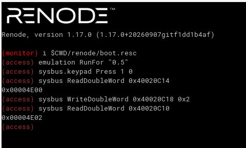

# Debug Log: Renode keypad scan hangs

Status: parked (2026-11-03), cause narrowed down to H4, see [Follow-ups](#follow-ups)  
Date: 2026-11-01 to 2026-11-03  
Renode 1.17.0 (portable `.deb`), `stm32f4_discovery-kit.repl` + `renode/KeypadMatrix.cs`  
Firmware: `build-firmware/stm32f407_access_control`  
Files involved: `renode/boot.resc`, `renode/stm32f407_access.repl`, `renode/KeypadMatrix.cs`, `Tests/renode/access.robot`, `keypad.c`, `stm32f407xx_gpio.c`


## Run Renode
Run inside the project root:
```bash
renode renode/boot.resc
```
## Important values

### Base addresses

| Register/Module | Function | Base Address |
| --- | --- | --- |
| GPIOD | Peripheral Base | 0x40020C00 |
| IDR | Input Data Register | 0x40020C10 |
| ODR | Output Data Register | 0x40020C14 |
| BSRR | Bit Set/Reset Register | 0x40020C18 |

### Register content

| Hex-Value | LED-Part | COLUMNS | x | ROWS |
| --- | --- | --- | --- | --- |
| 4F00 | 0100 | 1111 | 0000 | 0000 |
| 4E00 | 0100 | 1110 | 0000 | 0000 |
| 4E02 | 0100 | 1110 | 0000 | 0010 |
| 4F02 | 0100 | 1111 | 0000 | 0010 |
| 4E0E | 0100 | 1110 | 0000 | 1110 |
| 4B0E | 0100 | 1011 | 0000 | 1110 |
| 4D0E | 0100 | 1101 | 0000 | 1110 |

## Symptom
Robot test "Correct PIN Unlocks" fails. Keys in row 0 work, keys in row 1+ leave the
firmware stuck in `Keypad_Scan()`. Stuck state: ODR = `0x4E0E`, EXTI IMR = `0`.

| Key | Row | ODR after the key |
|-----|-----|-------------------|
| 1, 2, 3 | 0 | `0x4F00` (rows idle LOW, as expected) |
| 4 | 1 | `0x4E0E` (stuck) |
| 9 | 2 | `0x4B0E` (stuck) |
| 0 | 3 | `0x4D0E` (stuck) |

In every stuck state row 0 is LOW, rows 1-3 are HIGH and the column of the pressed key reads LOW.
That is the state in the middle of the row-0 pass of `Keypad_Scan()`.

## Hypotheses overview
| ID | Hypothesis | Status | Evidence |
|----|------------|--------|----------|
| [H1](#h1-timing-too-short) | Timing too short | rejected | [E1](#e1), [E2](#e2) |
| [H2](#h2-keypad-model-wrong) | Keypad model wrong | rejected | [E3](#e3) |
| [H3](#h3-renode-gpio-keeps-one-state-per-pin) | Renode GPIO: one state per pin (ODR read-modify-write is the cause) | refuted in this form | [E4](#e4), [E5](#e5), [E6](#e6), [E7](#e7), [E8](#e8) |
| [H4](#h4-input-changes-lost-during-a-write-to-the-same-port) | Input changes made during a write to the same port are lost | supported, mechanism not confirmed | [E6](#e6), [E7](#e7), [E8](#e8), [E9](#e9) |

## Setup findings (no hypothesis)
| # | Action | Result | Consequence |
|---|--------|--------|-------------|
| S1 | `cpu PC` after `LoadELF` | `0x0`; vector table at `0x08000000` holds SP `0x20020000`, reset handler `0x08000259` | set `VectorTableOffset`, SP and PC by hand (`boot.resc`, Robot "Prepare Machine") |
| S2 | `sysbus.cpu LogFunctionNames true` | log flood, Renode hangs (busy-polling main loop, no `wfi`) | use `AddSymbolHook` for single functions |
| S3 | `WhatPeripheralIsAt 0x40013800` (SYSCFG) | nothing; warnings "unimplemented register SYSCFG:EXTICR3" | harmless, EXTI still fires |
| S4 | `gpioPortD OnGPIO 8 false` | `EXTI9_5 hit` | interrupt path works |
| S5 | `sysbus.cpu PerformanceInMips` | `0x64` (100) by default | set to 16 (HSI clock) so delay loops take realistic simulated time |

## H1: timing too short
Status: rejected

The firmware needs real simulated time: `delay()` (300000 iterations) runs twice per key
and `Keypad_Scan()` waits for the key release.

| # | Action | Result | Conclusion |
|---|--------|--------|------------|
| [E1](#e1) | `PerformanceInMips 16`, `Press 0 0`, hold 1 s | ODR `0x4F00` | a row-0 key completes when given time |
| [E2](#e2) | Robot keyword "Wait For Idle" (rows LOW and IMR bits 8-11 set, up to 5 s simulated) | never idle, ODR `0x4E0E`, IMR `0` | firmware is stuck inside `Keypad_ReadEvent`, more time does not help |

## H2: keypad model wrong
Status: rejected

| # | Action | Result | Conclusion |
|---|--------|--------|------------|
| [E3](#e3) | logging added to `KeypadMatrix.cs` (row inputs, column outputs) | `Press 1 0`: `col 0 -> False`; row 1 HIGH: `col 0 -> True` | model logic is correct |

## H3: Renode GPIO keeps one state per pin
Status: refuted in this form. E8 shows that BSRR behaves like ODR, so the ODR write is not the cause. Only the ODR read part holds ([E5](#e5)).

Hypothesis: Renode's STM32 GPIO port keeps one state per pin, shared by input and output.
An ODR read returns the pin level, and an ODR write overwrites input pins.
On real hardware ODR holds only the output latch and ignores pins in input mode.

Original mechanism (refuted by E8):
1. A key is held, so column 0 is LOW and an ODR read returns bit 8 = 0.
2. `GPIO_WritePin(row, 1)` does `ODR |= bit`, which reads ODR (bit 8 = 0) and writes it all back.
3. The write sets the row pin, the keypad model drives column 0 HIGH, then the same write sets bit 8 to 0 again.
4. The port now reads LOW while the model believes HIGH. No further event corrects it,
   so `Keypad_Scan()` waits forever for a release.

Falsified if: in run B of E8 (BSRR) the IDR bit 8 reads 1. Result: it reads 0 in both runs, so H3 is refuted (see [H4](#h4-input-changes-lost-during-a-write-to-the-same-port)).

| # | Action | Result | Conclusion |
|---|--------|--------|------------|
| [E4](#e4) | `gpioPortD OnGPIO 8 false/true`, read IDR | bit 8 = 0 / 1 | control: the input path of the port works |
| [E5](#e5) | `Press 0 0`, read ODR | `0x0E00` (bit 8 = 0) | an ODR read returns the pin level |
| [E6](#e6) | `Press 1 0`, write ODR `0x4F0D` (row 1 LOW) | IDR bit 8 stays 1 | the column update triggered by the row write is lost (re-interpreted after E8, see H4) |
| [E7](#e7) | keypad log of the stuck run | last event "row 0 = False", no column change afterwards | firmware reads column LOW, model says HIGH |
| [E8](#e8) | run A (ODR read-modify-write) vs run B (BSRR) in the monitor | IDR `0x4E02` in both runs (bit 8 = 0) | prediction falsified: BSRR does not help |

## H4: input changes lost during a write to the same port
Status: supported (E9 matches all five predictions), mechanism not confirmed

Hypothesis: a write to the GPIO port changes a row pin. The keypad model answers inside that
callback by changing a column pin (input) of the same port. The port model loses that input change.
The same change delivered from outside a write (monitor command, `Release`) works.

| # | Action | Result | Conclusion |
|---|--------|--------|------------|
| [E6](#e6) | row 1 LOW written while `Press 1 0` is active | IDR bit 8 stays 1 | column update triggered by the write is lost |
| [E7](#e7) | keypad log of the stuck run | no column change after the last row write | same pattern in the firmware |
| [E8](#e8) | row 1 HIGH via ODR (run A) or BSRR (run B), model logs `col 0 -> True` | IDR bit 8 stays 0 in both | lost with both register paths, so not an ODR effect |
| [E9](#e9) | updates from outside a write (`Release`, `OnGPIO`) vs inside a write (BSRR) | outside: bit 8 follows (1); inside: stays 0 | only the update nested in the write is lost |

Consequence: after the lost update the keypad model still believes column 0 is HIGH, the port reads LOW.
The model sends no new edge, so the two stay out of sync until an external edge arrives ([E9](#e9), last step).

Not confirmed: why the update is lost. "Re-entrancy inside the port's write handler" is an interpretation of the
symptom; the source of the STM32 GPIO port in Renode has not been read.

Workaround ideas (untested):
- In `KeypadMatrix.cs` deliver the column update outside the port's write, e.g. scheduled through the machine
  (needs the `IMachine` injected into the constructor).
- Fix in Renode's GPIO port itself (separate topic, see Follow-ups).

## Experiment details

### E1
```
(access) sysbus.cpu PerformanceInMips 16
(access) sysbus.keypad Press 0 0
(access) emulation RunFor "1"
(access) sysbus.keypad Release 0 0
(access) emulation RunFor "1"
(access) sysbus ReadDoubleWord 0x40020C14
0x00004F00
```
Rows (bits 0-3) are idle LOW, the red LED (bit 14) is on. The firmware handled the key and returned to idle.

Related: [H1](#h1-timing-too-short)

### E2
Robot output of the three tests (printed by "Wait For Idle" before failing):
```
last odr=0x00004E0E imr=0x00000000    (Correct PIN Unlocks, key 4)
last odr=0x00004B0E imr=0x00000000    (Wrong PIN Stays Locked, key 9)
last odr=0x00004D0E imr=0x00000000    (Three Wrong PINs Lock Out, key 0)
```
`imr = 0` means the firmware sits inside `Keypad_ReadEvent()`, which masks the column interrupts
at the start and unmasks them at the end.

Related: [H1](#h1-timing-too-short)

### E3
Excerpt of the Renode log (after `Press 1 0`, firmware running):
```
[23:43:52.9883] [WARNING] keypad: col 0 -> False
[23:44:04.9812] [WARNING] keypad: keypad row 0 = True
[23:44:04.9814] [WARNING] keypad: keypad row 1 = True
[23:44:04.9814] [WARNING] keypad: col 0 -> True
[23:44:04.9816] [WARNING] keypad: keypad row 2 = True
[23:44:04.9817] [WARNING] keypad: keypad row 3 = True
[23:44:04.9819] [WARNING] keypad: keypad row 0 = False
```
The model drives column 0 LOW while the rows idle LOW and HIGH again once row 1 goes HIGH.
Its logic is correct.

Related: [H2](#h2-keypad-model-wrong)

### E4
```
(access) emulation RunFor "0.5"
(access) sysbus ReadDoubleWord 0x40020C10
0x00004F00
(access) gpioPortD OnGPIO 8 false
(access) sysbus ReadDoubleWord 0x40020C10
0x00004E00
(access) gpioPortD OnGPIO 8 true
(access) sysbus ReadDoubleWord 0x40020C10
0x00004F00
```
Bit 8 of the IDR follows `OnGPIO`: 1, 0, 1. The port itself accepts external input correctly.

Related: [H3](#h3-renode-gpio-keeps-one-state-per-pin)

### E5
```
(access) sysbus ReadDoubleWord 0x40020C14
0x00000F00
(access) sysbus.keypad Press 0 0
(access) sysbus ReadDoubleWord 0x40020C10
0x00000E00
(access) sysbus ReadDoubleWord 0x40020C14
0x00000E00
```
The emulation was paused, so the firmware wrote nothing between the reads. ODR bit 8 changed from 1 to 0
only because the pin level changed. An ODR read returns the pin level, not the output latch.

Related: [H3](#h3-renode-gpio-keeps-one-state-per-pin)

### E6
```
(access) sysbus WriteDoubleWord 0x40020C14 0x00004F0F
(access) sysbus.keypad Press 1 0
(access) sysbus ReadDoubleWord 0x40020C10
0x00004F0F
(access) sysbus WriteDoubleWord 0x40020C14 0x00004F0D
(access) sysbus ReadDoubleWord 0x40020C10
0x00004F0D
```
`0x4F0D` = `0100 1111 0000 1101`: row 1 (bit 1) LOW, rows 0, 2, 3 HIGH, columns (bits 8-11) HIGH.
With `Press 1 0` active, column 0 should now be LOW. IDR bit 8 stays 1, so the column update
that the row write triggers was lost (first read as an ODR overwrite, re-interpreted after E8).

Note: a first attempt wrote `0x0000000F`, which also cleared bits 8-11 and made the result meaningless.

Related: [H3](#h3-renode-gpio-keeps-one-state-per-pin), [H4](#h4-input-changes-lost-during-a-write-to-the-same-port)

### E7
Same log as [E3](#e3). After `row 0 = False` no further row or column event appears,
although the firmware should continue with row 1. The model reports all columns HIGH,
but the firmware reads column 0 as LOW and waits in the release loop.

Related: [H3](#h3-renode-gpio-keeps-one-state-per-pin), [H4](#h4-input-changes-lost-during-a-write-to-the-same-port)

### E8
Decisive test for H3 without changing the firmware. Start with `renode renode/boot.resc`, one fresh session per run.

Run A (simulates the old `GPIO_WritePin`, read-modify-write):
```
emulation RunFor "0.5"
sysbus.keypad Press 1 0
sysbus ReadDoubleWord 0x40020C14
sysbus WriteDoubleWord 0x40020C14 <value read above | 0x2>
sysbus ReadDoubleWord 0x40020C10
```
Prediction (H3): the log shows `col 0 -> True`, but IDR bit 8 reads 0.

Run B (BSRR):
```
emulation RunFor "0.5"
sysbus.keypad Press 1 0
sysbus WriteDoubleWord 0x40020C18 0x2
sysbus ReadDoubleWord 0x40020C10
```
Prediction (H3): IDR bit 8 reads 1.



The screenshot shows run B in a fresh session (BSRR write, IDR `0x4E02`, bit 8 = 0).
Run A was taken in a separate fresh session; its values are listed below.

Values of both runs:

```
Run A:  Press 1 0 -> ODR 0x00004E00;  WriteDoubleWord 0x40020C14 0x00004E02  ->  IDR 0x00004E02
Run B:  Press 1 0 -> ODR 0x00004E00;  WriteDoubleWord 0x40020C18 0x2         ->  IDR 0x00004E02
```
In both runs the log shows `col 0 -> False`, then `keypad row 1 = True` and `col 0 -> True`.
The model reports column 0 HIGH, but IDR bit 8 stays 0 with both register paths.
Prediction for run B (`0x4F02`) falsified, H3 refuted.

### E9
Fresh session, emulation paused between the commands:
```
(access) emulation RunFor "0.5"
(access) sysbus.keypad Press 1 0
(access) sysbus ReadDoubleWord 0x40020C10
0x00004E00
(access) sysbus.keypad Release 1 0
(access) sysbus ReadDoubleWord 0x40020C10
0x00004F00
(access) sysbus.keypad Press 1 0
(access) sysbus ReadDoubleWord 0x40020C10
0x00004E00
(access) sysbus WriteDoubleWord 0x40020C18 0x2
(access) sysbus ReadDoubleWord 0x40020C10
0x00004E02
(access) gpioPortD OnGPIO 8 true
(access) sysbus ReadDoubleWord 0x40020C10
0x00004F02
```

| Step | Predicted bit 8 (H4) | Observed | What it shows |
|------|----------------------|----------|---------------|
| `Press 1 0` (rows LOW) | 0 | 0 | model to port, LOW works |
| `Release 1 0` (outside a write) | 1 | 1 | model to port, HIGH works outside a write |
| `Press 1 0` again | 0 | 0 | as before |
| BSRR sets row 1 HIGH (inside a write) | 0 | 0 | the column update nested in the write is lost |
| `gpioPortD OnGPIO 8 true` | 1 | 1 | the port still accepts a plain external update |

All five predictions hit. The port is not broken: LOW and HIGH both work when they arrive outside a write.
The model also stays unaware of the loss, since it already believes column 0 is HIGH.

Related: [H4](#h4-input-changes-lost-during-a-write-to-the-same-port)

## Root cause
Supported by [E8](#e8) and [E9](#e9), mechanism not confirmed: a column update that the keypad model triggers
from inside a write to the same GPIO port is lost in Renode's port model, so the firmware reads a column LOW
that the model has already released. It is independent of how the firmware writes (ODR read-modify-write
or BSRR). On real hardware the keypad lines change independently of the write, so the firmware logic is not affected.

## Fix
Not decided yet. E8 shows that BSRR alone does not remove the Renode problem.
`GPIO_WritePin` / `GPIO_TogglePin` via BSRR (atomic, no ODR read) stays a code-quality item, independent of this bug.
Order of work if it is done:
1. add host tests (`GpioTest.cpp`), green on the old code
2. change both functions to BSRR
3. tests stay green

For the Renode test: deliver the column update outside the write (workaround ideas under [H4](#h4-input-changes-lost-during-a-write-to-the-same-port)).

## Verification
- [x] E8 done: run A and run B both leave IDR bit 8 = 0 (H3 refuted)
- [x] E9 done: all five predictions of H4 hit
- [ ] workaround in `KeypadMatrix.cs` or upstream fix
- [ ] host tests (`GpioTest.cpp`) green before and after a BSRR change
- [ ] `renode-test Tests/renode/access.robot` green (3 tests)

## Lessons
- Renode's GPIO model differs from hardware: ODR reads return the pin level, and input changes made during a write to the same port can be lost.
- Edge-based models can drift out of sync with the port; a model that sends only edges cannot repair a lost one.
- Wait for the firmware to be idle before injecting the next key.
- Isolate a hypothesis with a small monitor experiment before changing firmware code.
- Write the prediction down before the experiment: E8 falsified H3 and avoided a firmware change that would not have fixed the problem.
- `LogFunctionNames` on a busy-polling main loop floods the log; hook single functions instead.

## Follow-ups
- `.github/workflows/renode.yml` is added; the Robot test still fails, so the job is red until the workaround exists.
- Report the Renode behaviour upstream (tracked separately); read `STM32_GPIOPort.cs` first to confirm the mechanism.
