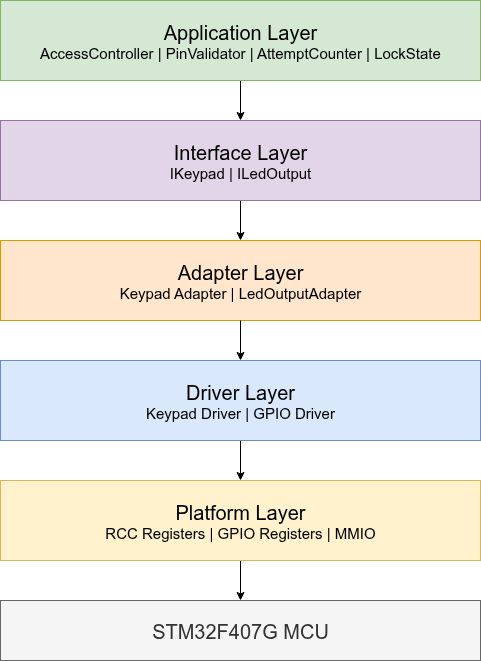
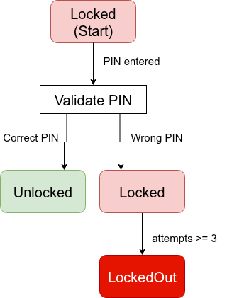

# System Architecture

## Overview

The STM32F407 Register-Level Access Control System follows a layered software architecture.

The main goal is to separate hardware-specific code from application logic.

The application layer is hardware independent and communicates with the STM32 peripherals through interfaces, adapters, and drivers.

This separation improves:

- maintainability
- testability
- hardware abstraction
- understanding of embedded system design

---

## Architecture Diagram



---

# Layer Description

## Application Layer

The application layer contains the system logic of the access control system.

Components:

- `AccessController`
- `PinValidator`
- `AttemptCounter`
- `LockState`

Responsibilities:

- processing user input
- validating PINs
- managing authentication states
- handling failed attempts and the lockout timeout
- controlling system behaviour

The application layer does not directly access STM32 registers or hardware peripherals.

---

## Access Controller State Machine

The AccessController is implemented as a finite state machine.

The controller manages the authentication process through three main states:

- Locked
- Unlocked
- LockedOut



Transitions:

| From | Event | To |
|---|---|---|
| Locked | correct PIN | Unlocked |
| Locked | wrong PIN | Locked (attempt counted) |
| Locked | third wrong PIN | LockedOut |
| Unlocked | valid new PIN submitted | Locked (PIN replaced) |
| Unlocked | invalid or incomplete input | Unlocked (input discarded) |
| LockedOut | `kLockoutMs` elapsed | Locked (attempts reset) |

### Input handling

Key processing is shared between `Locked` and `Unlocked` in one function (`ProcessKey()`), so both states behave identically:

- digits are appended to a four-digit buffer
- `#` submits the buffer
- any other key aborts the input and clears the buffer
- a fifth digit also aborts the input instead of being dropped silently

Aborted and incomplete inputs are not counted as failed attempts. Only a complete four-digit PIN that does not match increments the attempt counter.

### Lockout timeout

In `LockedOut` the keypad is no longer scanned. The state stores the time of the lockout (`lockoutStartMs_`) and checks on every `Update()` call whether `kLockoutMs` (30 s) has elapsed:

```cpp
(clock_.NowMs() - lockoutStartMs_) >= kLockoutMs
```

The subtraction is done in `uint32_t` arithmetic, so the check stays correct when the millisecond counter wraps around after about 49.7 days.

---

## Interface Layer

The interface layer defines abstract hardware interfaces used by the application.

Interfaces:

- `IKeypad`
- `ILedOutput`
- `IClock`

Responsibilities:

- provide hardware-independent access to input, output and time
- allow application testing without real hardware

The application only depends on these interfaces.

`IClock` exposes a single function, `NowMs()`, which returns a monotonic millisecond counter. The controller never reads a hardware timer itself; time is injected through the constructor.

---

## Adapter Layer

The adapter layer connects the application interfaces with the hardware-specific drivers.

Components:

- `KeypadAdapter`
- `LedOutputAdapter`
- `SysTickClock`

Responsibilities:

- implement application interfaces
- translate application requests into driver calls
- isolate hardware details from application logic

Example:

The application requests:

`leds.Green();`

The adapter translates this into a hardware-specific operation using the LED driver.

`SysTickClock` implements `IClock` with the Cortex-M SysTick timer. `SysTickClock::Init()` configures a 1 ms tick, and the `SysTick_Handler` increments a counter that `NowMs()` returns. It accesses the SysTick registers directly, because this is the only place where the application meets the timer. Moving this register access into a separate driver is a possible refinement.

---

## Driver Layer

The driver layer provides low-level access to peripherals.

Components:

- GPIO driver
- Keypad driver (interrupt-driven)
- SWO driver
- Fault handler (HardFault diagnostics)

Responsibilities:

- configure peripherals
- read input signals
- control output signals
- perform hardware operations
- provide debug output and crash diagnostics

The driver layer communicates directly with the platform layer.

The keypad driver is interrupt-driven: all rows are held low while idle, so a key press pulls a column low and triggers an EXTI interrupt. The interrupt handler only sets a flag; debouncing and matrix scanning run in the main loop.

The fault handler overrides the weak `HardFault_Handler` of the vector table. It determines the stack in use at the time of the fault, then prints the stacked registers and the fault status registers over SWO. See [SWO Debugging](swo.md).

---

## Platform Layer

The platform layer represents the STM32F407 hardware.

Components:

- GPIO register definitions
- RCC register definitions
- SYSCFG, EXTI and NVIC register definitions
- SysTick and SCB fault register definitions
- debug and trace register definitions (ITM, TPIU, DEMCR, DBGMCU)
- memory-mapped peripheral definitions

Responsibilities:

- provide access to MCU registers
- define hardware addresses
- describe peripheral structures

This layer contains the lowest-level hardware representation.

---

# Dependency Direction

The dependency direction follows a strict downward flow:

```text
Application  
↓  
Interfaces  
↓  
Adapters  
↓  
Drivers  
↓  
Platform  
↓  
STM32F407 Hardware
```

Higher layers do not directly depend on lower-level hardware details.

---

# Design Decisions

## No STM32 HAL

The project intentionally avoids STM32 HAL and CubeMX generated code.

Reasons:

- understand MCU internals
- learn register-level programming
- control the complete software stack

---

## Hardware Abstraction

Hardware access is separated from application logic.

Benefits:

- application code can be tested on a host system
- hardware components can be replaced
- software structure remains maintainable

---

## Time as an Injected Dependency

The lockout timeout needs a time source. Instead of reading the SysTick counter inside the controller, the controller receives an `IClock`.

Benefits:

- tests control time explicitly (`MockClock`) and run instantly instead of waiting 30 seconds
- edge cases such as the exact timeout boundary and counter wraparound are testable
- the controller stays free of register access

---

## Module Interaction

The main application flow is:

```text
User Input  
→ Keypad Driver  
→ KeypadAdapter  
→ AccessController  
→ PinValidator / AttemptCounter  
→ LedOutputAdapter  
→ GPIO Driver
```

The AccessController coordinates the authentication process and uses interfaces to communicate with hardware-dependent components. In the `LockedOut` state it additionally queries `IClock`, which is backed by `SysTickClock` on the target.

The main loop sleeps with `wfi`. Key interrupts and the 1 ms SysTick interrupt wake the CPU, so the controller is updated at least once per millisecond. This is what makes the lockout timeout work without a separate timer callback.

## Testable Application Design

The application layer uses interfaces instead of concrete hardware implementations.

This allows the use of mocks during unit testing.

Example:

```text
AccessController  
↓  
IKeypad / ILedOutput / IClock  
↓  
MockKeypad / MockLedOutput / MockClock
```

The access control logic can therefore be tested without an STM32 connected.
