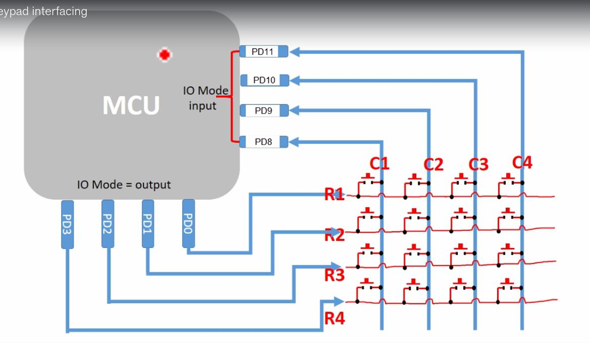

# Keypad Connection

## Overview

The system uses a 4x4 matrix keypad as user input device.

The keypad is connected directly to GPIO pins of the STM32F407VG.

The keypad driver scans the matrix by activating rows and reading column states. The scan is started by a column interrupt, so the MCU does not have to poll the keypad continuously.

## Wiring



## Pin Assignment

| Signal | MCU Pin | Direction | Configuration |
|---|---|---|---|
| Row 1 | PD0 | Output | idle LOW |
| Row 2 | PD1 | Output | idle LOW |
| Row 3 | PD2 | Output | idle LOW |
| Row 4 | PD3 | Output | idle LOW |
| Column 1 | PD8 | Input | pull-up, EXTI8 |
| Column 2 | PD9 | Input | pull-up, EXTI9 |
| Column 3 | PD10 | Input | pull-up, EXTI10 |
| Column 4 | PD11 | Input | pull-up, EXTI11 |

## Key Layout


```text
    1 2 3 A
    4 5 6 B
    7 8 9 C
    * 0 # D
```

## Interrupt Configuration

In idle state all rows are driven LOW. The columns are held HIGH by their pull-up resistors. A key press connects a column to a LOW row and pulls the column LOW.

This produces a falling edge on the column pin, which triggers the corresponding EXTI line.

| Column | EXTI line | IRQ handler |
|---|---|---|
| Column 1 (PD8) | EXTI8 | `EXTI9_5_IRQHandler` |
| Column 2 (PD9) | EXTI9 | `EXTI9_5_IRQHandler` |
| Column 3 (PD10) | EXTI10 | `EXTI15_10_IRQHandler` |
| Column 4 (PD11) | EXTI11 | `EXTI15_10_IRQHandler` |

Port D is selected for EXTI8-11 in `SYSCFG->EXTICR3`, the trigger is a falling edge (`EXTI->FTSR`).

## Event Flow

```text
Key press

↓

Column pulled LOW (falling edge)

↓

EXTI interrupt

↓

ISR: clear EXTI->PR, set flag

↓

Main loop wakes up from wfi

↓

Debounce and matrix scan (EXTI->IMR masked)

↓

Key event via Keypad_ReadEvent()
```

The interrupt handlers do not scan or debounce. They only clear the pending flag and set a flag for the main loop. The interrupt mask is released again after the scan, when the rows are back in the idle state (`Keypad_SetIdle()`).

## Implementation

The keypad hardware is accessed through the keypad driver.

The driver handles:

- row activation
- column reading
- matrix scanning
- key detection
- EXTI and NVIC configuration (`Keypad_Init()`)
- interrupt flag handling (`Keypad_IrqPending()`)
- key events for the application (`Keypad_ReadEvent()`)

The application layer reads the keypad through `KeypadAdapter::Scan`.
