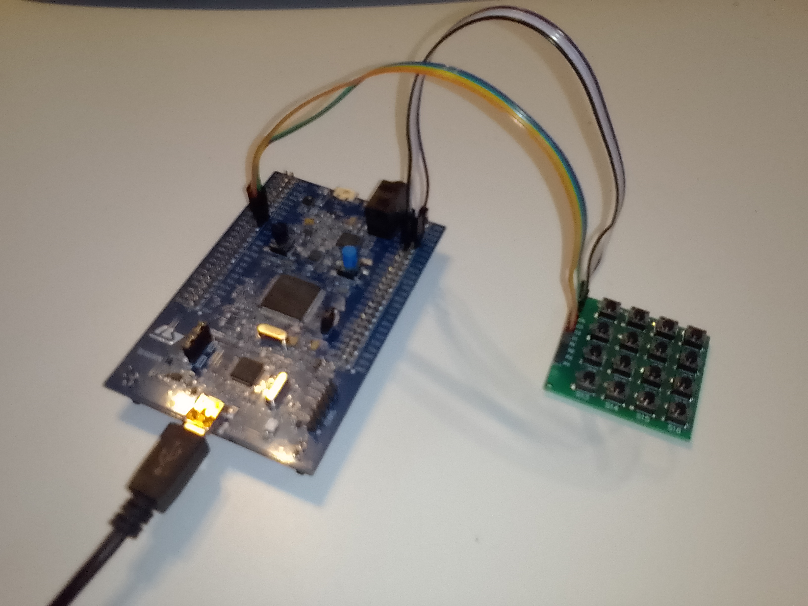

# STM32F407 Register-Level Access Control System

This project intentionally avoids STM32 HAL and CubeMX-generated code. Every peripheral
is configured directly through its registers, to demonstrate the full path from MCU
startup to application logic without framework abstractions in between.

## Target Hardware



- STM32F407G-DISC1
- ARM Cortex-M4
- 4x4 Matrix Keypad
- On-board LEDs (Green LED / Red LED)

The firmware directly controls the MCU peripherals through register-level access.

A detailed description of the hardware setup, connections and pin assignments can be found here:

[Hardware Overview](Docs/hardware.md)

<br clear="right"/>

## Toolchain

The project is built using a minimal toolchain consisting of:

- arm-none-eabi-gcc
- CMake
- ST-LINK
- OpenOCD
- gdb-multiarch (Ubuntu) or arm-none-eabi-gdb
- GNU Make

## Build

The project provides a Makefile as the main entry point.

Show available commands:
```bash
make help
```

### Build Firmware
```bash
make firmware
```

### Build and run host tests
```bash
make tests
```

## Testing

Host-based unit tests use [GoogleTest](https://github.com/google/googletest) (fetched via CMake `FetchContent`) and run without hardware:

```bash
make tests
```

| Executable | Covers |
|---|---|
| `unit_tests` | Application logic (`AccessController`, `PinValidator`, `AttemptCounter`) with mocks, and `KeypadAdapter` with a stubbed driver |
| `driver_tests` | Keypad driver (`keypad.c`): EXTI handlers, `Keypad_ReadEvent()` with a simulated key matrix |
| `platform_tests` | EXTI/NVIC register configuration (`stm32f407xx_exti.c`) against RAM-backed registers |

The hardware tests build with `-DUNIT_TEST`, which redirects the peripheral pointers to RAM structs. Write-1-to-clear behaviour of registers is not emulated; the tests check the value written.

All tests run in GitHub Actions on every push.

Not covered yet: `Keypad_Init()`, `Keypad_EnableInterrupt()`, `LedOutputAdapter`. Planned: on-target tests (Unity) and an emulator run (Renode).

## Flash and Debug

### Flash firmware
```bash
make flash
```

### Start OpenOCD
```bash
make openocd
```

### Start GDB
```bash
make gdb
```

### Runtime debug output via SWO
```bash
make openocd   # terminal 1
make swo       # terminal 2
tail -f swo.log  # terminal 3
```

SWO (Serial Wire Output) runs over the same USB connection as flashing and debugging,
no UART, no extra wiring. Output is written to `swo.log`.

More details: [SWO Debugging](Docs/swo.md)

More details about startup and memory layout:

[Startup Code](Docs/startup.md)  
[Linker Script](Docs/linker-script.md)

## Features

The firmware provides a complete PIN-based access control system:

- register-level GPIO programming
- custom keypad input driver
- PIN authentication
- failed attempt tracking and lockout protection
- LED-based status feedback
- SWO runtime debug output (register-level ITM/TPIU configuration)
- host-based unit tests (GoogleTest) for application logic, keypad driver and EXTI configuration, run in CI

## Architecture

A layered architecture separates hardware-specific code from application logic.

The main components are:

- Application layer: AccessController, PinValidator, AttemptCounter
- Hardware interfaces: IKeypad, ILedOutput
- Hardware adapters: KeypadAdapter, LedOutputAdapter

The application layer does not directly access STM32 registers.

A detailed description of the architecture and design decisions can be found in the [Architecture Documentation](Docs/architecture.md).

## Technical Concepts

- Memory-Mapped I/O
- Pointer Casting
- Bitwise Operations
- Struct-Based Register Mapping
- Volatile Qualifier
- Embedded Driver Architecture
- State Machine Design
- Layered Software Architecture
- Hardware Abstraction
- Dependency Inversion
- Unit Testing with GoogleTest (Mocks, Stubs, Hardware Fakes)
- CoreSight Trace (ITM/ TPIU)

Details about the MCU register mapping:

[Register Map](Docs/register_map.md)

## Project Summary

The project has been completed and validated on real hardware.

The STM32F407-based access control system implements register-level hardware control, a layered software architecture, runtime trace output via SWO, host-based unit tests (GoogleTest) and hardware debugging using ST-LINK, OpenOCD and GDB.